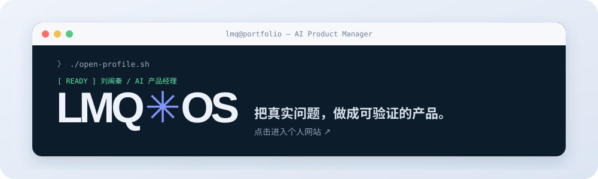
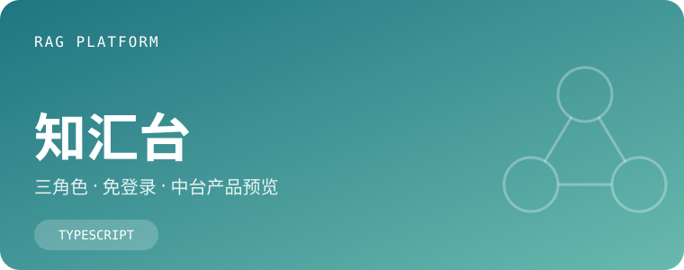
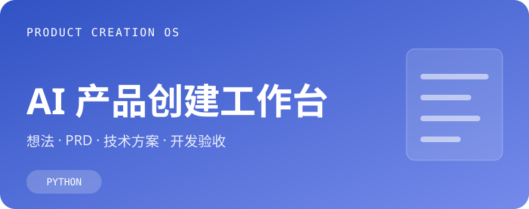
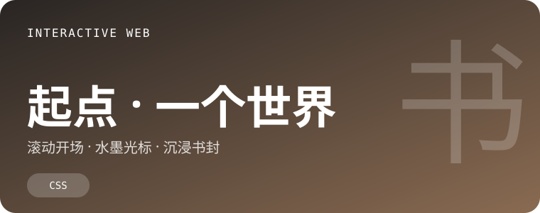
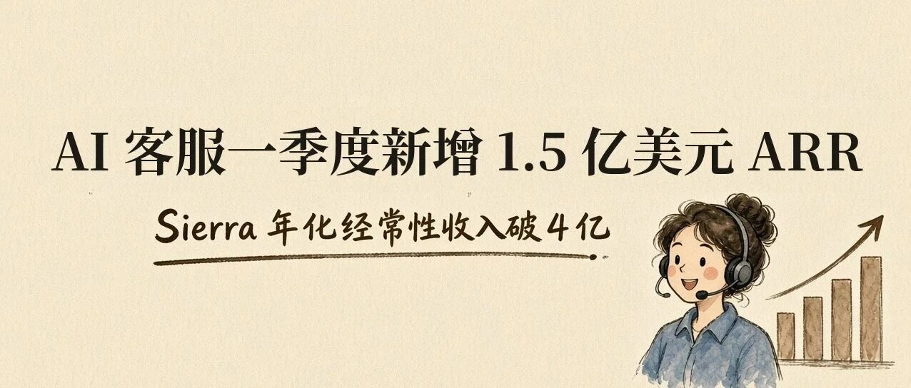
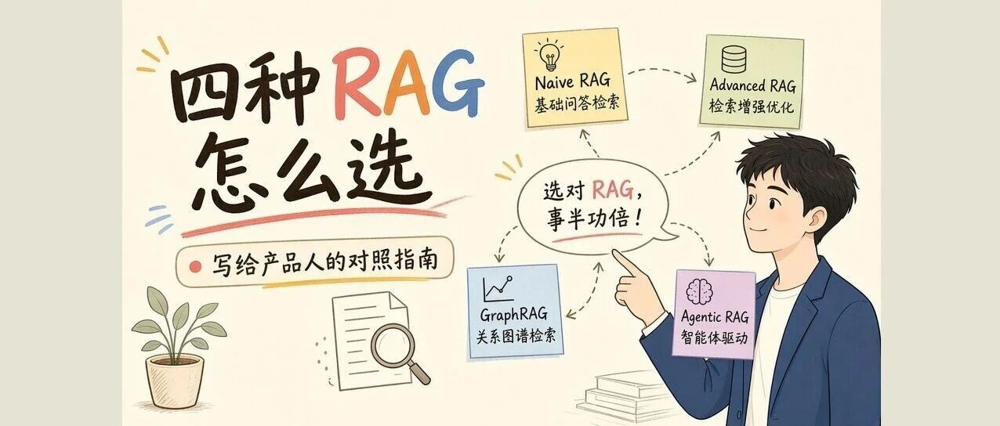

# 你好，我是刘闽秦 👋

  

点击上方工作台，打开我的个人网站

  🌐 <a href="https://ethan101-liu.github.io/">个人网站</a> · 🧩 <a href="https://github.com/Ethan101-Liu?tab=repositories">全部项目</a> · ✍️ <a href="./ARTICLES.md">文章归档</a> · ✉️ <a href="mailto:minqinliu997@gmail.com">邮箱</a>

---

## 关于我

我是刘闽秦，一名 **AI 产品经理**。我关注用户需求、技术能力与业务价值之间的连接，尝试把复杂的模型能力转化为清晰、可靠、可验证的产品体验。

- 🔭 正在持续构建 AI 产品、交互原型与工作流
- 🧠 关注 Agent、RAG、人机协作和 AI 产品评测
- ✍️ 持续记录 AI 产品、模型能力与行业变化
- 💬 欢迎围绕 AI 产品与产品实践交流

## ⭐ 精选项目

  
  

  
  

  
  

<strong>项目说明与在线体验</strong>

- **暖屿用户端**：围绕完整用户体验构建的高保真互动原型。
- **试穿搭子**：支持自配模型、连续换装、穿搭对比与本地衣柜的中文 AI 试衣工作台。[在线体验](https://ethan101-liu.github.io/tryon-buddy/)
- **知汇台**：面向三类角色的免登录 RAG 中台产品预览。
- **AI 产品创建工作台**：覆盖想法、PRD、技术方案、开发任务和逐项验收。[在线体验](https://ethan101-liu.github.io/product-creation-workbench/)
- **起点互动单页**：包含滚动剑仙开场、水墨技能书光标与沉浸式书封舞台。
- **室内设计工作流**：覆盖需求、方案、生图、改图与建模落地。[在线体验](https://ethan101-liu.github.io/xiaoliu-Interior-design-skill/)

<a href="https://ethan101-liu.github.io/#projects"><strong>在个人网站浏览全部项目</strong></a>

## ✍️ 公开文章

  
  

企业 Agent 商业化观察 · 写给产品人的 RAG 对照指南

<strong>查看全部 8 篇文章</strong>

| 日期 | 文章 | 主题 |
| --- | --- | --- |
| 2026-11-01 | [AI 客服一个季度新增 1.5 亿美元 ARR，Sierra 年化收入破 4 亿](https://mp.weixin.qq.com/s/PYems8VVvLhI8Bkp-s1F1A) | 企业 Agent |
| 2026-11-01 | [戴上眼镜看外语片，手机实时出译文](https://mp.weixin.qq.com/s/DGnxXgQ9FdvD3WkXciUoQA) | AI 硬件 |
| 持续更新 | [Agent 砍半价，电脑操作要卷成标配了？](https://mp.weixin.qq.com/s/YBD3XLy0L9ELQVst6SsMqA) | Computer Use |
| 2026-10-27 | [安全公司也要上市了，Claude 叙事会怎么变？](https://mp.weixin.qq.com/s/0lXp1vD5rosg6Ah_C3EeFg) | 行业观察 |
| 2026-10-27 | [OpenAI 把最强模型关断网，CPU 缓存传话到底有多离谱？](https://mp.weixin.qq.com/s/1mCZdO4RM-o4AnWRraw7Qg) | 模型能力 |
| 2026-10-26 | [下一仗是长任务能不能干完](https://mp.weixin.qq.com/s/yHt07PtDmmLZhiJUgON8sQ) | 长任务 Agent |
| 2026-10-23 | [下一笔预算，先别急着换更高分模型](https://mp.weixin.qq.com/s/CgpdkoohkjhULGPiwwWFjg) | AI 产品工程 |
| 2026-10-23 | [四种 RAG 怎么选：写给产品人的对照指南](https://mp.weixin.qq.com/s/XjJV_oYGcv8r-hU1TffYWQ) | RAG |

<a href="./ARTICLES.md"><strong>浏览完整文章归档</strong></a>

<strong>🚧 接下来</strong>

- [ ] 补充更多真实 AI 产品案例
- [ ] 整理产品文档与评测方法
- [ ] 持续发布 AI 产品观察文章

---

让 AI 能力，成为可落地的产品。

